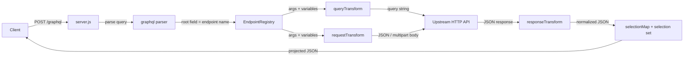

# JSONata Federation

`hrbolek/jsonata-federation` is a lightweight Dockerized API gateway that exposes a GraphQL-like endpoint over one or more REST/HTTP APIs.

It uses:

- GraphQL syntax as a request/query language,
- JSON endpoint registry loaded at runtime,
- JSONata expressions for request and response transformations,
- selection-set based field projection and renaming,
- optional forwarding of selected headers such as cookies and authorization tokens.

The main use case is to create a small configurable facade over heterogeneous REST APIs without writing a full GraphQL server or requiring OpenAPI specifications.

---

## How it works



For every root field in the incoming GraphQL operation the gateway:

1. looks up an endpoint with the same `name` in the registry,
2. reads the field arguments (including `$variables`),
3. builds the upstream URL from `url`, `urlTemplate` or `buildUrl`,
4. optionally appends a query string produced by `queryTransform`,
5. optionally builds the request body with `requestTransform` or `body`,
6. calls the upstream API and parses the JSON response,
7. optionally reshapes the response with `responseTransform`,
8. projects the result onto the requested selection set using `selectionMap`.

Root fields are resolved sequentially, so a single GraphQL operation can combine several upstream services.

---

## Docker image

```bash
docker pull hrbolek/jsonata-federation:latest
```

Available image variants may include:

```text
hrbolek/jsonata-federation:latest
hrbolek/jsonata-federation:node22-alpine
hrbolek/jsonata-federation:node22-bookworm-slim
hrbolek/jsonata-federation:node20-alpine
hrbolek/jsonata-federation:node20-bookworm-slim
```

---

## Exposed endpoints

The container exposes port `3000` by default.

| Endpoint | Method | Description |
|---|---:|---|
| `/graphql` | `POST` | Main GraphQL-like gateway endpoint |
| `/health` | `GET` | Basic health check |
| `/health` | `POST` | Echo endpoint useful for testing transformations |
| `/debug` | `GET` | Built-in fixed debug call to `/graphql` |
| `/debug/query` | `GET` | Debug endpoint that accepts query and variables from URL query params |

### `/graphql`

Accepts either `application/json` or `multipart/form-data` (GraphQL multipart request convention).

JSON body:

```json
{
  "query": "query { ... }",
  "variables": {},
  "operationName": "OptionalOperationName"
}
```

Response status codes:

| Status | Meaning |
|---:|---|
| `200` | All root fields resolved successfully |
| `207` | Partial success — at least one root field failed, see `errors` |
| `400` | Invalid request: missing `query`, unknown `operationName`, or ambiguous operation |
| `500` | Unexpected server error, including a query that fails to parse |

A failed root field is returned as `null` and reported in `errors` with a `path`, so one broken upstream does not discard the rest of the response.

Note that a GraphQL syntax error is not distinguished from an internal failure: `parse()` throws, the outer handler catches it and responds with `500`.

### `/health`

`GET` returns the registry size and the effective header whitelist:

```json
{
  "ok": true,
  "method": "GET",
  "endpoints": 2,
  "forwardedHeaders": ["cookie", "authorization", "accept-language"]
}
```

`POST` additionally echoes the parsed JSON body in `payload`. This makes it a convenient upstream target for testing `requestTransform` and `responseTransform`.

### `/debug` and `/debug/query`

Both endpoints call `/graphql` on the same process and return the request that was sent together with the response that came back. They are intended for local troubleshooting only.

`/debug` uses a hard-coded query against `healthOne`.

`/debug/query` accepts these URL query parameters:

| Parameter | Description |
|---|---|
| `query` | Required. GraphQL query string |
| `variables` / `vars` | Optional JSON string with variables |
| `operationName` | Optional operation name |
| `authorization` | Optional value for the `authorization` header |
| `cookie` | Optional value for the `cookie` header |
| `acceptLanguage` | Optional value for the `accept-language` header |
| `requestId` | Optional value for the `x-request-id` header |

---

## Environment variables

| Variable | Default | Description |
|---|---|---|
| `PORT` | `3000` | HTTP port the server listens on |
| `ENDPOINTS_CONFIG_PATH` | — | Path to the endpoint configuration file |
| `ENDPOINTS_JSON` | — | Endpoint configuration as an inline JSON string. Takes priority over `ENDPOINTS_CONFIG_PATH` |
| `FORWARD_HEADERS` | `cookie,authorization,accept-language` | Comma-separated whitelist of forwardable headers. Empty value disables forwarding |
| `JSON_BODY_LIMIT` | `1mb` | Body size limit for `application/json` requests |
| `MULTIPART_BODY_LIMIT` | `50mb` | Body size limit for `multipart/form-data` requests. Accepts `b`, `kb`, `mb`, `gb` suffixes |

If neither `ENDPOINTS_CONFIG_PATH` nor `ENDPOINTS_JSON` is set, the server starts with an empty registry and logs a warning. Every root field then fails with `Endpoint '<name>' is not registered.`

---

## Quick start with Docker Compose

Create `docker-compose.yml`:

```yaml
services:
  serverjsonata:
    image: hrbolek/jsonata-federation:latest
    ports:
      - "8303:3000"
    environment:
      PORT: "3000"
      ENDPOINTS_CONFIG_PATH: /app/config/endpoints.json
      FORWARD_HEADERS: cookie,authorization,accept-language,x-request-id
    volumes:
      - ./serverjsonata/endpoints.json:/app/config/endpoints.json:ro
```

Start the container:

```bash
docker compose up
```

The gateway is then available at:

```text
http://localhost:8303/graphql
```

---

## Configuration

Endpoint configuration can be provided in two ways.

### Option 1: Configuration file

Set:

```bash
ENDPOINTS_CONFIG_PATH=/app/config/endpoints.json
```

and mount your configuration file into the container:

```yaml
volumes:
  - ./serverjsonata/endpoints.json:/app/config/endpoints.json:ro
```

### Option 2: JSON directly in ENV

For small demos, you can provide the full configuration as an environment variable:

```bash
ENDPOINTS_JSON='[
  {
    "name": "healthOne",
    "method": "POST",
    "url": "http://localhost:3000/health"
  }
]'
```

If both `ENDPOINTS_JSON` and `ENDPOINTS_CONFIG_PATH` are provided, `ENDPOINTS_JSON` has priority.

---

## Example `endpoints.json`

This example defines two logical endpoints. Both call the same internal test endpoint `POST /health`, but each uses a different request and response transformation.

```json
[
  {
    "name": "healthOne",
    "method": "POST",
    "url": "http://localhost:3000/health",
    "forwardHeaders": true,
    "requestTransform": "{ \"id\": args.id, \"name\": args.name, \"source\": \"healthOne\", \"nested\": { \"value\": args.value } }",
    "responseTransform": "{ \"ok\": ok, \"service\": \"self-health-one\", \"requestMethod\": method, \"originalPayload\": payload, \"payloadId\": payload.id, \"payloadName\": payload.name, \"payloadValue\": payload.nested.value, \"forwardedHeaders\": forwardedHeaders }",
    "selectionMap": {
      "ok": "ok",
      "service": "service",
      "method": "requestMethod",
      "id": "payloadId",
      "name": "payloadName",
      "value": "payloadValue",
      "payload": "originalPayload",
      "forwardedHeaders": "forwardedHeaders"
    }
  },
  {
    "name": "healthTwo",
    "method": "POST",
    "url": "http://localhost:3000/health",
    "forwardHeaders": true,
    "requestTransform": "{ \"external_id\": args.id, \"display_name\": args.name, \"source\": \"healthTwo\", \"meta\": { \"amount\": args.value } }",
    "responseTransform": "{ \"ok\": ok, \"service\": \"self-health-two\", \"requestMethod\": method, \"raw\": payload, \"id\": payload.external_id, \"title\": payload.display_name, \"amount\": payload.meta.amount, \"forwardedHeaders\": forwardedHeaders }",
    "selectionMap": {
      "ok": "ok",
      "service": "service",
      "method": "requestMethod",
      "id": "id",
      "name": "title",
      "value": "amount",
      "payload": "raw",
      "forwardedHeaders": "forwardedHeaders"
    }
  }
]
```

---

## Endpoint configuration reference

Each endpoint can have the following properties.

| Property | Required | Description |
|---|---:|---|
| `name` | yes | Root GraphQL field name used to select the endpoint |
| `method` | no | HTTP method. Defaults to `GET` |
| `url` | yes/no | Static upstream URL |
| `urlTemplate` | yes/no | URL template with placeholders, for example `/users/{id}` |
| `buildUrl` | no | Function `(args, variables) => string`. Only usable when the registry is populated from code, not from JSON |
| `headers` | no | Static headers added to the upstream request |
| `forwardHeaders` | no | If `true`, selected incoming headers are forwarded |
| `queryTransform` | no | JSONata expression evaluated against `{ args, variables }`, result is appended to the URL as query parameters |
| `requestTransform` | no | JSONata expression evaluated against `{ args, variables }`, result becomes the request body |
| `body` | no | Static request body used when `requestTransform` is absent |
| `requestEncoding` | no | `json` (default) or `multipart` |
| `encoding` | no | Alias for `requestEncoding` |
| `multipart` | no | Multipart layout: `fields`, `files`, `bodyField`, `bodyContentType`, `bodyFilename` |
| `responseTransform` | no | JSONata expression evaluated against the upstream JSON response |
| `selectionMap` | no | Maps public GraphQL field names to transformed/upstream JSON fields |

At least one of `url` or `urlTemplate` is required.

Unknown properties are ignored, so a configuration file can carry extra metadata without breaking the server.

### URL resolution order

The upstream URL is resolved in this order, first non-empty value wins:

1. `buildUrl(args, variables)`
2. `urlTemplate` with `{placeholder}` substitution
3. `url`

Placeholders are replaced with `encodeURIComponent(String(value))`. A missing or `null` argument raises `Missing URL template argument '<key>'.`

### Request body resolution order

For methods other than `GET` and `HEAD` with `requestEncoding: "json"`:

1. `requestTransform` result
2. `body`
3. the raw GraphQL arguments object

The result is serialized with `JSON.stringify` and `content-type: application/json` is set.

---

## URL templates

Use `urlTemplate` when GraphQL arguments should be inserted into the upstream URL.

```json
{
  "name": "userById",
  "method": "GET",
  "urlTemplate": "https://api.example.com/users/{id}",
  "selectionMap": {
    "id": "user_id",
    "name": "full_name"
  }
}
```

Request:

```graphql
query {
  userById(id: 10) {
    id
    name
  }
}
```

The upstream URL becomes:

```text
https://api.example.com/users/10
```

---

## Request transformation

`requestTransform` is a JSONata expression evaluated against:

```json
{
  "args": {},
  "variables": {}
}
```

Example:

```json
{
  "name": "userSearch",
  "method": "POST",
  "url": "https://api.example.com/users/search",
  "requestTransform": "{ \"search\": args.term, \"limit\": args.limit ? args.limit : 20 }"
}
```

GraphQL request:

```graphql
query {
  userSearch(term: "john", limit: 5) {
    items {
      id
      name
    }
  }
}
```

The upstream POST body becomes:

```json
{
  "search": "john",
  "limit": 5
}
```

`requestTransform` is only applied to methods other than `GET` and `HEAD`. For `GET` requests use `queryTransform` instead.

---

## Query string transformation

`queryTransform` is a JSONata expression evaluated against the same `{ args, variables }` context, but its result is appended to the URL as query parameters instead of being sent as a body.

```json
{
  "name": "userSearch",
  "method": "GET",
  "url": "https://api.example.com/users",
  "queryTransform": "{ \"skip\": 0, \"where\": { \"name\": { \"_ilike\": \"%\" & args.term & \"%\" } }, \"take\": args.limit ? args.limit : 25 }"
}
```

GraphQL request:

```graphql
query {
  userSearch(term: "john", limit: 3) {
    total
    items {
      id
      name
    }
  }
}
```

The upstream URL becomes:

```text
https://api.example.com/users?skip=0&where=%7B%22name%22%3A%7B%22_ilike%22%3A%22%25john%25%22%7D%7D&take=3
```

Rules:

- the expression must evaluate to a JSON object, otherwise the request fails with `queryTransform must evaluate to a JSON object.`,
- scalar values are stringified, objects and arrays are JSON-serialized — this makes Hasura-style filters such as `where` and `order_by` possible,
- `undefined` and `null` values are omitted,
- existing query parameters in `url` or `urlTemplate` are preserved.

---

## Multipart requests

Set `requestEncoding` to `multipart` to send `multipart/form-data` upstream. This is the counterpart of the GraphQL multipart request convention on the client side: the client uploads a file, the gateway forwards it to a REST API that expects a form.

```json
{
  "name": "signDocument",
  "method": "POST",
  "url": "https://sign.example.com/api/sign",
  "requestEncoding": "multipart",
  "multipart": {
    "fields": {
      "personId": "args.personId",
      "reason": "args.reason"
    },
    "files": {
      "file": "args.file"
    }
  }
}
```

`fields` and `files` values are dot paths resolved against `{ args, variables }`. A `files` value may also be an array of files, which produces a repeated multipart field.

Field values are appended as follows:

| Value type | Encoding |
|---|---|
| `string` | as-is |
| `number`, `boolean`, `bigint` | `String(value)` |
| object, array | `JSON.stringify(value)` |
| `File` / `Blob` | appended as a file part |
| `undefined`, `null` | skipped |

### JSON metadata part

If `requestTransform` is present together with `multipart.bodyField`, the transform result is attached as a single JSON part instead of being spread over `fields`:

```json
{
  "name": "uploadWithMeta",
  "method": "POST",
  "url": "https://files.example.com/api/upload",
  "requestEncoding": "multipart",
  "requestTransform": "{ \"personId\": args.personId, \"note\": args.note }",
  "multipart": {
    "bodyField": "metadata",
    "bodyContentType": "application/json",
    "bodyFilename": "metadata.json",
    "files": {
      "file": "args.file"
    }
  }
}
```

`bodyContentType` defaults to `application/json` and `bodyFilename` to `metadata.json`. With any other content type the transformed value is appended as a plain string via `String(value)`, so an object becomes `[object Object]` — use `application/json` for structured metadata.

Binary `File`/`Blob` values are never passed to JSONata. Inside `requestTransform` and `queryTransform` they are replaced by a metadata object:

```json
{
  "__file": true,
  "name": "invoice.pdf",
  "type": "application/pdf",
  "size": 12345
}
```

### Client-side upload example

```bash
curl -X POST http://localhost:8303/graphql \
  -F 'operations={"query":"mutation Upload($file: Upload) { signDocument(personId: \"P1\", reason: \"test\", file: $file) { ok } }","variables":{"file":null}}' \
  -F 'map={"0":["variables.file"]}' \
  -F '0=@invoice.pdf;type=application/pdf'
```

The `content-type` header of the incoming request is never forwarded upstream, because the outgoing `FormData` must generate its own boundary.

---

## Response transformation

`responseTransform` is a JSONata expression evaluated against the raw upstream JSON response.

Example upstream response:

```json
{
  "user_id": 10,
  "full_name": "Jan Novak",
  "address": {
    "city": "Brno"
  }
}
```

Endpoint configuration:

```json
{
  "name": "userById",
  "method": "GET",
  "urlTemplate": "https://api.example.com/users/{id}",
  "responseTransform": "{ \"id\": user_id, \"name\": full_name, \"city\": address.city }"
}
```

Transformed response:

```json
{
  "id": 10,
  "name": "Jan Novak",
  "city": "Brno"
}
```

---

## Selection map and field renaming

`selectionMap` maps public GraphQL field names to JSONata paths or expressions.

```json
{
  "selectionMap": {
    "id": "user_id",
    "name": "full_name",
    "city": "address.city"
  }
}
```

GraphQL request:

```graphql
query {
  user: userById(id: 10) {
    id
    displayName: name
    city
  }
}
```

Response:

```json
{
  "data": {
    "user": {
      "id": 10,
      "displayName": "Jan Novak",
      "city": "Brno"
    }
  }
}
```

The GraphQL alias `displayName: name` is preserved in the final response.

---

## Nested selection map

Nested objects and arrays can be mapped using `path` and `fields`.

```json
{
  "name": "userSearch",
  "method": "POST",
  "url": "https://api.example.com/users/search",
  "responseTransform": "{ \"items\": users, \"total\": total_count }",
  "selectionMap": {
    "items": {
      "path": "items",
      "fields": {
        "id": "user_id",
        "name": "full_name",
        "city": "address.city"
      }
    },
    "total": "total"
  }
}
```

GraphQL request:

```graphql
query {
  userSearch(term: "john") {
    total
    items {
      id
      name
      city
    }
  }
}
```

---

## Selection set semantics

The gateway does not have a schema. The selection set is applied to the already transformed JSON, which has a few consequences worth knowing.

### Projection without `selectionMap`

When an endpoint has no `selectionMap`, the selection set is used as a plain projection: only the requested fields are copied, under their existing names. Aliases are honoured.

```graphql
query {
  plain {
    user_id
    renamed: full_name
    address { city }
  }
}
```

```json
{
  "data": {
    "plain": {
      "user_id": 1,
      "renamed": "Jan",
      "address": { "city": "Brno" }
    }
  }
}
```

### Projection with `selectionMap`

When `selectionMap` is present, a JSONata object expression is generated from the selection set and evaluated against the transformed response. This means:

- only fields present in the selection set are returned,
- a field missing from `selectionMap` falls back to its own name,
- nested selections recurse into `fields`,
- if the mapped path points to an array, JSONata maps the object construction over the array items automatically.

### Root field without a selection set

If a root field is requested without a selection set, the whole transformed response is returned unprojected:

```graphql
query { one: healthOne(id: 1, name: "A", value: 2) }
```

### Not supported

The gateway parses the query but does not validate it against a schema. The following GraphQL features are not implemented:

| Feature | Behaviour |
|---|---|
| Introspection (`__schema`, `__type`) | Treated as an unregistered endpoint and reported in `errors` |
| Fragments (`...F`, inline `... on X`) | Silently skipped — the field resolves to `{}` |
| Directives (`@include`, `@skip`) | Ignored |
| Field arguments on nested fields | Ignored; only root field arguments are read |
| Variables inside nested selections | Not applicable, since nested fields are not resolved |
| `mutation` / `subscription` | Parsed, but handled exactly like `query` |

### Operation selection

If `operationName` is provided, the operation with that name is used. Otherwise, if the document contains exactly one operation, that operation is used. If the document contains several named operations and no `operationName`, the request fails with `No GraphQL operation found.`

---

## Header forwarding

Header forwarding is controlled by a global whitelist and per-endpoint opt-in.

Default forwarded headers:

```text
cookie,authorization,accept-language
```

You can override the whitelist with:

```bash
FORWARD_HEADERS=cookie,authorization,accept-language,x-request-id
```

To enable forwarding for an endpoint:

```json
{
  "name": "userById",
  "method": "GET",
  "urlTemplate": "https://api.example.com/users/{id}",
  "forwardHeaders": true
}
```

To disable global forwarding completely, set:

```bash
FORWARD_HEADERS=
```

The following hop-by-hop headers are never forwarded:

```text
host
connection
content-length
transfer-encoding
upgrade
keep-alive
proxy-authenticate
proxy-authorization
te
trailer
```

---

## Testing

### Health check

```bash
curl http://localhost:8303/health
```

### POST health echo

```bash
curl -X POST http://localhost:8303/health \
  -H "content-type: application/json" \
  -d '{"hello":"world"}'
```

Expected response:

```json
{
  "ok": true,
  "method": "POST",
  "endpoints": 2,
  "forwardedHeaders": [
    "cookie",
    "authorization",
    "accept-language",
    "x-request-id"
  ],
  "payload": {
    "hello": "world"
  }
}
```

### GraphQL gateway test

```bash
curl -X POST http://localhost:8303/graphql \
  -H "content-type: application/json" \
  -H "authorization: Bearer test-token" \
  -H "x-request-id: abc-123" \
  -d '{
    "query": "query { one: healthOne(id: 10, name: \"Alpha\", value: 42) { ok service method id name value payload forwardedHeaders } two: healthTwo(id: 20, name: \"Beta\", value: 84) { ok service method id name value payload forwardedHeaders } }"
  }'
```

### Debug endpoint with fixed query

```bash
curl http://localhost:8303/debug
```

### Debug endpoint with query from URL

```bash
curl --get http://localhost:8303/debug/query \
  --data-urlencode 'query=query { first: healthOne(id: 1, name: "Test", value: 123) { isOk: ok endpoint: service requestMethod: method renamedId: id renamedName: name renamedValue: value } }'
```

Direct browser URL:

```text
http://localhost:8303/debug/query?query=query%20%7B%20first%3A%20healthOne(id%3A%201%2C%20name%3A%20%22Test%22%2C%20value%3A%20123)%20%7B%20isOk%3A%20ok%20endpoint%3A%20service%20requestMethod%3A%20method%20renamedId%3A%20id%20renamedName%3A%20name%20renamedValue%3A%20value%20%7D%20%7D
```

### Debug endpoint with variables

```bash
curl --get http://localhost:8303/debug/query \
  --data-urlencode 'query=query TestQuery($id: Int!, $name: String!, $value: Int!) { first: healthOne(id: $id, name: $name, value: $value) { isOk: ok endpoint: service renamedId: id renamedName: name renamedValue: value } }' \
  --data-urlencode 'variables={"id":7,"name":"FromVars","value":777}'
```

---

## Browser playground

`index.html` is a single-file playground with a query textarea, a variables textarea and a JSON response pane. It posts to the relative path `/graphql`, so it must be served from the same origin as the gateway.

`nginx.conf` provides exactly that: it serves the static page and proxies `/graphql` to the `serverjsonata` service, forwarding `Authorization`, `Cookie`, `Accept-Language` and `X-Request-Id`.

`docker-compose.jsonata.yml` wires both together:

```yaml
services:
  serverjsonata:
    image: hrbolek/jsonata-federation:latest
    ports:
      - "8303:3000"
    environment:
      PORT: "3000"
      FORWARD_HEADERS: cookie,authorization,accept-language,x-request-id
      ENDPOINTS_JSON: >
        [
          {
            "name": "whoami",
            "method": "GET",
            "url": "http://whoami/api",
            "forwardHeaders": true
          }
        ]

  whoami:
    image: traefik/whoami:latest

  jsonata-ui:
    image: nginx:alpine
    ports:
      - "8304:80"
    volumes:
      - ./serverjsonata/index.html:/usr/share/nginx/html/index.html:ro
      - ./serverjsonata/nginx.conf:/etc/nginx/conf.d/default.conf:ro
    depends_on:
      - serverjsonata
```

Start it with:

```bash
docker compose -f docker-compose.jsonata.yml up
```

Then open `http://localhost:8304` and run:

```graphql
query {
  whoami {
    host
    method
    url
  }
}
```

`traefik/whoami` returns `hostname`, `ip`, `headers`, `url`, `host`, `method` and `remoteAddr`. Note that `headers` is an object, so requesting it without a nested selection set returns the whole object.

The playground is a development aid. It has no authentication and no query validation, so do not expose it publicly.

---

## Docker build

The Dockerfile supports alternative base images through the `NODE_IMAGE` build argument.

```dockerfile
ARG NODE_IMAGE=node:22-alpine
FROM ${NODE_IMAGE}
```

Build with the default base image:

```bash
docker build -f Dockerfile.JSONata -t hrbolek/jsonata-federation .
```

Build with an alternative base image:

```bash
docker build \
  -f Dockerfile.JSONata \
  --build-arg NODE_IMAGE=node:22-bookworm-slim \
  -t hrbolek/jsonata-federation:node22-bookworm-slim .
```

`Dockerfile.JSONata` is the supported build file. It installs dependencies from `serverjsonata/package.json` and copies only the runtime files into `/app`:

```dockerfile
COPY serverjsonata/package*.json ./
RUN npm install --omit=dev

COPY serverjsonata/*.js serverjsonata/endpoints.json ./
```

`serverjsonata/package.json` declares only the three packages the gateway actually imports — `express`, `graphql` and `jsonata` — plus `"type": "module"`. It is deliberately separate from the repository root `package.json`, which carries the Apollo and GraphQL Tools dependencies used by `server01.js` and `server31.js`. Building from the root manifest pulled in those unused packages and produced a 462 MB image; the current build is 257 MB and starts without the `MODULE_TYPELESS_PACKAGE_JSON` warning.

`serverjsonata/Dockerfile` is a legacy variant and does not build. It runs `COPY ../package*.json ./`, which escapes the Docker build context, so `npm install` fails with `ENOENT` regardless of whether the context is the repository root or `serverjsonata/`. The `docker-compose.yml` inside `serverjsonata/` uses `build: .` and therefore hits the same failure. Use `Dockerfile.JSONata` from the repository root instead:

```bash
docker build -f Dockerfile.JSONata -t hrbolek/jsonata-federation .
```

`Dockerfile.ui` builds a standalone nginx image containing only `index.html` and `nginx.conf`:

```bash
docker build -f serverjsonata/Dockerfile.ui -t hrbolek/jsonata-federation-ui ./serverjsonata
```

---

## Running without Docker

The server is an ES module. `serverjsonata/package.json` declares `"type": "module"`, so running it from that directory works directly:

```bash
cd serverjsonata
npm install
PORT=3000 \
ENDPOINTS_CONFIG_PATH=./endpoints.json \
FORWARD_HEADERS=cookie,authorization,accept-language,x-request-id \
node server.js
```

Running `node serverjsonata/server.js` from the repository root does not work, because Node resolves the nearest `package.json` — the root one — which has no `"type": "module"` and is shared with the CommonJS files `server01.js` and `server31.js`:

```text
SyntaxError: Cannot use import statement outside a module
```

---

## GitHub Actions

A release workflow can build and publish multiple image variants using a matrix:

```text
node:22-alpine
node:22-bookworm-slim
node:20-alpine
node:20-bookworm-slim
```

Required GitHub secrets:

```text
DOCKER_USERNAME
DOCKER_PASSWORD
```

Recommended image name:

```text
hrbolek/jsonata-federation
```

---

## Project structure

| File | Purpose |
|---|---|
| `server.js` | Express app, HTTP routes, GraphQL parsing, endpoint dispatch, header forwarding |
| `endpointRegistry.js` | Endpoint registry, URL building, JSONata evaluation, selection-set projection |
| `multipart.js` | GraphQL multipart request parsing and upstream multipart body construction |
| `endpoints.json` | Example endpoint configuration |
| `package.json` | Runtime dependencies (`express`, `graphql`, `jsonata`) and `"type": "module"` |
| `index.html` | Single-file browser playground |
| `nginx.conf` | nginx config that serves the playground and proxies `/graphql` |
| `docker-compose.yml` | Legacy compose file, builds from the broken `serverjsonata/Dockerfile` |
| `Dockerfile` | Legacy build file, does not build (see Docker build) |
| `Dockerfile.ui` | Standalone nginx image with the playground |

The supported build file lives in the repository root as `Dockerfile.JSONata`, because it needs the repository root as build context to reach `serverjsonata/`.

---

## Design notes

This project is not a full GraphQL server with schema validation and type-safe resolvers. It is a lightweight GraphQL-like facade for HTTP APIs.

It is useful when:

- upstream APIs do not have OpenAPI specifications,
- several REST APIs need to be unified quickly,
- field names and payload shapes differ between services,
- transformations should be configured instead of hard-coded,
- a small Dockerized adapter is preferred over a larger API gateway platform.

Root fields are resolved one after another, not in parallel. This keeps error reporting and header forwarding simple, but it means a query touching several slow upstreams takes the sum of their latencies.

---

## Security notes

Be careful with header forwarding.

Forwarding `cookie` or `authorization` means that upstream services receive the caller's authentication context. This is often desirable for internal services, but it should be explicitly controlled.

Recommended practice:

- keep `FORWARD_HEADERS` as a whitelist,
- enable `forwardHeaders` only for trusted endpoints,
- avoid forwarding headers to third-party APIs unless intended,
- do not log sensitive headers in production,
- consider adding request size limits and upstream allowlists.

Additional points specific to this implementation:

- The gateway performs no authentication or authorization of its own. Access control must be enforced by the upstream APIs or by a proxy in front of the gateway.
- `url` and `urlTemplate` are taken from configuration, never from the query, so clients cannot redirect the gateway to arbitrary hosts. Keep the configuration file read-only and trusted.
- `JSON_BODY_LIMIT` and `MULTIPART_BODY_LIMIT` are the only request size guards. Lower them for public deployments.
- `/debug` and `/debug/query` echo request details and are meant for local use only.
- The playground in `index.html` has no authentication.

---

## License

Add your project license here, for example:

```text
MIT
```
